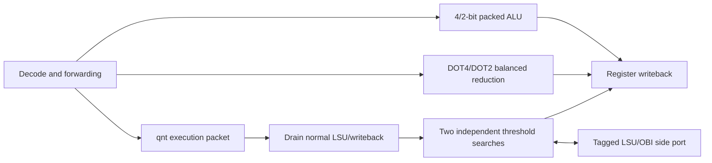

# FYP: Low-Precision RISC-V Processor

> 中文摘要：本项目基于 OpenHW CV32E40P 实现 DATE 2020 XpulpNN 范围内的 4/2-bit packed ALU、dot/sdot 与双通道阈值量化，并提供独立模型、整核仿真、FPGA OOC 和可复现证据。

This Final Year Project extends a frozen CV32E40P baseline with a local `DATE2020-local-v1` low-precision ABI. It implements 72 instruction forms: packed 4-bit and 2-bit arithmetic, dot/sdot operations, and two quantization forms. It does not claim binary compatibility with the paper authors' compiler or include later MAC&LOAD, NN-RF, or unequal-width dot-product extensions.

## Architecture



Each 32-bit packed word has eight Q4 lanes or sixteen Q2 lanes. A quantization instruction converts two signed-16 accumulators through two threshold tables that are 64 bytes apart. Results write back only at the final done handshake, preserving ordinary LSU response ownership.

## Repository layout

| Path | Contents |
|---|---|
| [`rtl`](rtl) | Core overlays, low-precision execution units and FPGA wrapper |
| [`verification`](verification) | Independent models, software kernels, SV test benches and runners |
| [`scripts`](scripts) | Vivado project and OOC implementation Tcl scripts |
| [`docs`](docs) | Design ABI, paper analysis, test index and final report |
| [`vendor/cv32e40p`](vendor/cv32e40p) | Frozen upstream source and provenance manifest |
| [`artifacts`](artifacts) | Compact evidence, fixed benchmark ROM and result summaries |

The original [`FYP.xpr`](FYP.xpr) is retained as a baseline reference. Its recorded SHA-256 is `9d348bcda279dbd563006ed12d1ae816f06b0ff66022e54145c753f7af3f0e82`. It deliberately preserves the original machine-specific source references, so it is provenance rather than a portable project file; use the RTL, scripts, and verification environment to reproduce the work on a new machine. Generated Vivado caches, checkpoints and simulation logs are intentionally not versioned.

## Quick verification

The portable test suite requires Python 3.12 or later and no proprietary FPGA tools.

```powershell
python -m unittest discover -s verification/tests -v
python scripts/check_public_repository.py --index
```

These checks validate the local ABI/model, source hashes, fixed ROM inputs and public repository boundary. They do not run XSim, Vivado, or a physical FPGA.

For a Windows host with compatible installed tools, run the full core regression:

```powershell
./verification/scripts/run_tests.ps1 -Config overlay_nn1 -Suite all -Seed 1
./verification/scripts/run_tests.ps1 -Config overlay_nn1 -Suite obi_stress -Seed 42 -GrantMax 7 -ResponseMax 11
./verification/scripts/run_tests.ps1 -Config overlay_nn1 -Suite obi_stress -Seed 20261020 -GrantMax 7 -ResponseMax 11
```

Adjust the local tool paths in the scripts for another machine. The shared FPGA-wrapper ROM is pinned under [`artifacts/verification/overlay_nn1/bench/1/20261021-114500-136671`](artifacts/verification/overlay_nn1/bench/1/20261021-114500-136671).

## Results

Functional release evidence reports PASS for 19 top-level groups and 42 leaf tests; three OBI stress seeds have current RTL/testbench hashes. The full expanded system OOC implementation meets 20 ns (50 MHz): 8,745 LUT, 2,863 FF, 7 DSP, 32 BRAM tiles, WNS +0.594 ns and WHS +0.025 ns. The NN-enabled 10 ns OOC implementation does not meet timing and remains recorded as a failure.

The main benchmark comparison is the project’s portable legacy XPULP dot8 path against the native low-precision path. It includes the legacy path's required unpack/sign-extension and software quantization. It is not the paper authors' optimized baseline, and whole-program cycles are not used as speedup.

- [Final validation report](docs/results/xpulpnn-route-a-validation.md)
- [Verification evidence index](docs/results/verification-index.md)
- [Benchmark comparison](docs/results/benchmark-comparison.md)
- [Independent RTL review](docs/results/independent-review.md)
- [Approved local ABI specification](docs/superpowers/specs/2026-10-20-xpulpnn-cv32e40p-design.md)

## Scope limits

The results establish functional simulation and OOC implementation evidence. They do not establish KV260 pin assignments, board-clock hookup, bitstream programming, hardware execution, or power consumption.

## License and third-party code

Original project files are released under [Apache-2.0](LICENSE). The frozen CV32E40P source and recursive vendor components retain their own licenses; see [Third-party notices](THIRD_PARTY_NOTICES.md) and [`vendor/cv32e40p`](vendor/cv32e40p).
