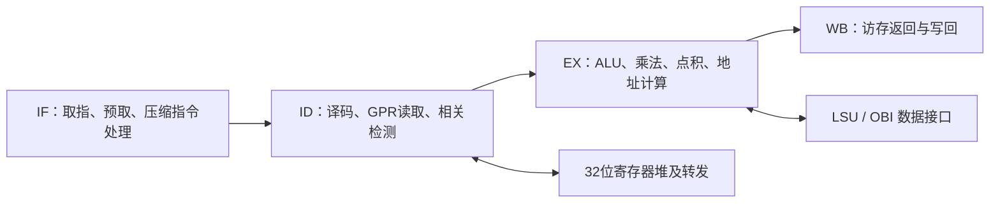

# CV32E40P / XpulpNN 项目审查、论文解读与待确认架构

日期：2026-10-20。对象：`C:\Users\CEG\FYP\FYP.xpr` 与用户提供的 DATE 2020 XpulpNN 论文。

后续状态：用户已在本报告交付后确认第7节的路线A。详细技术约定见 `docs/superpowers/specs/2026-10-20-xpulpnn-cv32e40p-design.md`，实施步骤见 `docs/superpowers/plans/2026-10-20-xpulpnn-cv32e40p.md`；两者待实施前审核。以下调研和基线验证结果保留其原有证据范围，不表示扩展已经实现。

## 1. 结论及当前验证边界

**CV32E40P 具有实现这篇论文所需的基础结构，值得继续实施；目前完成的是源代码审查、论文要求提取和基线编译/展开，尚未完成扩展 RTL、指令功能验证或 FPGA 时序验证。**

不能将以下几件事等同：

1. 现有核心能够被综合或仿真器展开。
2. 新增的 2/4 位运算在流水线中执行正确。
3. 新增指令能提高完整内核的运行速度。
4. 加入存储器、时钟和板级接口后，设计能够布线、满足时序并上板运行。

本次有证据支持第 1 项。第 2 至 4 项还需要后续实现和实验。当前工程以及 E 盘 RTL 均未修改；新建内容仅为调研文档和独立的基线编译探针。

## 2. 当前 Vivado 项目是什么

### 2.1 来源与配置

- 工程目标器件：`xck26-sfvc784-2LV-c`；板卡定义：`xilinx.com:kv260_som:part0:2.0`。
- 综合顶层：`cv32e40p_top`。
- 工程参数：`COREV_PULP=1`、`COREV_CLUSTER=0`、`FPU=0`、`ZFINX=0`。因此当前配置是整数核心加 PULP 扩展，浮点单元未启用。
- 主要 RTL 位于 `E:\cv32e40p-master\cv32e40p-master\rtl`，通过绝对路径加入工程；FYP 目录内的自定义 RTL 为 `FYP.srcs\sources_1\new\cv32e40p_clock_gate.sv`。
- 工程中的 129 个实际设计源文件引用均能找到。不能因 FYP 目录中缺少多数 RTL 就认为源文件丢失。
- FYP 目录和 E 盘源目录都没有 `.git` 版本库，无法直接用现有 Git 历史确定本地来源。

本次通过 GitHub API 固定上游 master 提交 `b353438ff469c030c89f6804f3b24a2852880e8b`（提交时间 2026-10-13 UTC），对 top、core、ALU、mult、decoder、ID、EX、LSU、controller 和 package 共 10 个关键文件进行 SHA-256 比较，均逐字节一致。比较记录见同目录 `upstream-comparison.json`。这支持其与上游核心的关系，但不是整个目录的版本鉴定或全部依赖的一致性证明。

### 2.2 核心的工作方式

CV32E40P 是 RV32、单发射、顺序执行的四级流水线：

PULP 扩展已经提供 8/16 位 packed SIMD、点积及累加点积、硬件循环、后增量访存等结构。`sdot` 的第三输入是旧目的寄存器，可沿用现有第三操作数和转发通路；不必为这篇论文增加 NN-RF。

相关修改位置不是单个乘法器，而是 package → decoder → ID → EX → datapath，以及量化单元涉及的 core/LSU 控制通路。

### 2.3 已有综合结果与工程缺口

现有综合报告的设计状态为 `Synthesized`，时间为 2026-10-20，资源如下：

| 项目 | 当前报告 |
| --- | ---: |
| LUT | 6,976 / 117,120 |
| Flip-flop | 1,590 |
| Latch | 992 |
| DSP | 7 / 1,248 |
| BUFGCE | 33 |
| Bonded IOB | 351 / 189（185.71%） |

这份报告说明曾完成综合，**不说明已经完成布局布线或通过功能测试**。逻辑资源尚有余量只是初步有利条件，不能据此推算扩展后的频率与功耗。

必须处理的工程问题：

- `sim_1` 没有实际测试源，仿真顶层仍为 `cb_filter`，不是处理器测试平台。
- `constrs_1` 没有 XDC，不能据此宣称满足某个工作频率。
- 裸核把指令/数据总线、调试等信号直接暴露为芯片 I/O，超过器件可用 I/O；上板需要包含片上存储器和少量外设接口的封装。
- 当前使用 latch 寄存器堆，时钟门控映射为 BUFGCE。FPGA 版本应评估 FF 寄存器堆、时钟使能和门控映射；对基线和扩展核采用相同适配后再比较。

## 3. 论文实际提出什么

依据的是用户附件 **XpulpNN: Accelerating Quantized Neural Networks on RISC-V Processors Through ISA Extensions**，DATE 2020，印刷页 186–191，共 6 页。这里将用户所说的 microconfiguration 理解为论文 III-B 的 **Microarchitecture（微架构）**。

**这篇论文没有 MAC&LOAD、NN-RF 或不同输入位宽的 8×4 / 4×2 点积。** 图 3 中 `8x4 MAC Unit` 的含义是 8 个 4 位元素，`16x2` 是 16 个 2 位元素。后续同名 XpulpNN 期刊论文的扩展不能混入本次复现。

### 3.1 ISA 扩展

32 位 GPR 和数据总线保持不变，数据按元素打包：

| 精度 | 每个32位寄存器的元素数 | 有符号范围 | 无符号范围 |
| --- | ---: | --- | --- |
| 8位（现有） | 4 | -128…127 | 0…255 |
| 4位，nibble，`.n` | 8 | -8…7 | 0…15 |
| 2位，crumb，`.c` | 16 | -2…1 | 0…3 |

Table II 要求增加：

| 类别 | 指令族 | 关键行为 |
| --- | --- | --- |
| 加减与平均 | `pv.add/sub/avg/avgu` | 每个 lane 独立运算 |
| 最值 | `pv.min/minu/max/maxu` | 区分有符号与无符号比较 |
| 移位 | `pv.srl/sra/sll` | 每个 lane 独立移位 |
| 绝对值 | `pv.abs` | 每个 lane 的绝对值 |
| 点积 | `pv.dotup/dotusp/dotsp` | 8个4位或16个2位乘积求和，32位结果 |
| 累加点积 | `pv.sdotup/sdotusp/sdotsp` | 在点积基础上加旧 `rd`，32位累加 |
| 阈值量化 | `pv.qnt.n/c` | 两个16位激活压缩为两个低位宽输出 |

除 `abs` 和 `qnt` 外，上述表中的运算提供向量–向量和标量广播 `.sc` 形式。论文明确不增加子字节 `.sci` 立即数形式，原因是编码空间有限。

必须在正式规格中固定的细节包括：lane 顺序、每个操作数的符号解释、平均值截断规则、移位量规则、最小负数的 abs、32 位累加溢出、非法编码处理。尤其 `dotusp` 的操作数顺序不能只根据论文中的文字推断：当前 CV32E40P 的已有 ISA 约定必须明确核对。

### 3.2 点积微架构

论文保留现有 16/8 位运算区域，增加独立的：

- 8 路 4 位乘法区域和加法树。
- 16 路 2 位乘法区域和加法树。
- 32 位累加输入及结果选择。
- 各精度区域的输入保持/隔离，抑制未使用区域的翻转。

有符号/无符号元素在乘法前扩展一位，因此统一表示所需的乘法输入宽度分别为 5 位和 3 位。不能将论文正文中疑似排版错误的 “5- or 2-bit” 照抄为电路要求。

论文选择分离各精度乘法器及加法树，以减少资源共享带来的选择逻辑和关键路径；dot/sdot 目标为单周期，并支持连续相关累加。在 FPGA 上能否维持目标频率必须实际综合和布线后判断。

实现时的常见错误是中间求和过早截断。例如 4 位无符号点积最大为 `8×15×15=1800`；4 位有符号点积可以达到 `8×(-8)×(-8)=512`。单个乘积的位宽并不足以承载整个点积。

### 3.3 `pv.qnt` 微架构

这不是简单的移位、截断或 clamp。它对预训练阈值执行二叉搜索，形成阶梯量化函数。

- 输入 A：两个打包的 16 位激活。
- 输入 B：第一个通道的阈值树入口地址；第二个通道地址由固定偏移导出。
- Q 位输出每个通道需要 `2^Q−1` 个阈值，沿搜索路径访问 Q 个阈值。
- 两个激活分别保存搜索路径和结果，比较阶段与地址更新阶段流水化，两个通道交错执行。
- 活跃期间占用 LSU，并暂停核心后续执行；完成后只写回一次。
- 论文最终设计在其无访存停顿条件下，两个 4 位结果需要 9 周期，两个 2 位结果需要 5 周期。

论文中早期未流水化方案的 5/3 周期针对单个结果，而且造成系统关键路径增加 90%；不能把它当作最终设计。

论文没有充分定义机器码、相等阈值归属、阈值表精确内存布局/填充、第二通道地址偏移、输出位域与未使用位。因此可以做**明确记录本地约定的功能复现**，但不能仅凭论文声称与原作者二进制兼容。

## 4. 映射到当前 CV32E40P 时的实际工作

### 4.1 数据通路和控制宽度

- `cv32e40p_pkg.sv` 当前 `MUL_OP_WIDTH=3` 已有 7 个操作码；同时增加 DOT4、DOT2 时不能假定有两个空位。可扩展到 4 位，或增加独立点积精度控制。
- `VEC_MODE32/16/8` 当前使用 2 位字段；5 种模式需要扩展到 3 位，或增加辅助精度控制。修改必须贯穿所有端口、寄存器和断言。
- 当前乘法点积由 `mult_operator` 控制，不能只修改 ALU 的 `vector_mode`。
- ID 对 ALU 和乘法操作数有不同的更新使能。新增运算必须在正确的流水线握手时捕获操作数和精度，不能依赖未更新的 ALU 寄存器。
- ALU 要保证 lane 间不串进位，正确实现广播、比较、平均和移位。

### 4.2 编码兼容性

现有 CV32E40P 已经使用多个 custom opcode；custom-3 内的 8/16 位 SIMD、extract、shuffle、pack、complex 等编码必须逐一检查。不能仅以“保留空间”命名就认定它为空。

推荐要求：新增编码不覆盖已支持的指令；扩展关闭时保留原有行为；使用 `.word` / `.insn` 软件封装可先绕开完整编译器移植，但必须提供准确编码表和反汇编证据。

在未取得作者对应版本的规范编码前，软件和报告应标为 FYP 自定义编码的 XpulpNN 功能复现。

### 4.3 量化和 LSU

当前 LSU 存在未完成事务，返回通路没有任意暂停数据返回的机制。量化单元至少要：

1. 正确处理之前尚未返回的普通 load/store，避免把旧数据当作阈值。
2. 按请求接受握手前进，在 backpressure 时保持地址和请求。
3. 为每个请求记录所属激活、树层级和响应去向。
4. 任何允许出现返回的周期都能捕获数据，不能只在特定 FSM 状态采样。
5. 两个激活独立更新树路径，覆盖一左一右的情况。
6. 阈值返回不直接触发普通 GPR load 写回；最终量化结果仅提交一次。
7. 保持 EX stall、相关检测、转发、异常、复位和调试行为一致。

先以正确的握手和功能为验收条件，再测量是否能在指定存储器模型下达到 9/5 周期。核心不同、总线时序不同或增加安全等待时，应如实报告额外周期。

## 5. 发现的另一套旧草稿

`D:\fyp-xpulpnn` 中存在旧的 `src\cv32e40p-xpulpnn` 和 ISA 文档，但当前 FYP.xpr 不引用它。该源码库基于提交 `7a49867b2232d97344cde1b8a1e05bcb38634894`，含未提交的 RTL 修改；本次仅阅读，没有修改。

不能直接把它当作已验证实现：

- 量化代码使用 `gt1 || gt2` 决定两个激活共享的下一节点。若两个激活应走不同路径，至少一个结果会错误。
- 一个具体反例：2位量化树根阈值 0、左子阈值 -10、右子阈值 10，两个激活为 -5 与 15。两个独立搜索的比较码应为 `01` 与 `11`；共享右分支会得到 `00` 与 `11`。这是路径选择错误，与最终输出采用哪种符号编码无关。
- 请求接口缺少明确的接受确认；请求脉冲及只在部分状态接收返回数据的方式需要重新审计。
- 其 ISA 文档与源代码的编码分配存在差异；部分源代码按配置复用既有 extract/shuffle/complex 编码，不能直接声称完全向后兼容。
- 旧草稿还存在量化精度控制未更新、每条指令的搜索状态未有效清零、连续量化无法重新启动及忙碌期间写回控制未正确限定等问题；详细行号见 `core-audit.md` 第6节。

可以把旧草稿用作测试反例和实现参考，但迁移到当前核心前必须重新设计和验证。

## 6. 本次实际运行的验证

发现并使用：

- Vivado/XSim 2026.1：`E:\vivado\2026.1\Vivado\bin`。
- RISC-V GCC 15.2.0：`D:\fyp-xpulpnn\tools\xpack-riscv-none-elf-gcc-15.2.0-1\bin`。
- Codex bundled Python 3.12.14。

在 `docs\investigation\baseline` 建立独立源清单及运行脚本，使用当前 FYP 引用的源代码和时钟门控文件，选择与现有综合一致的 latch 寄存器堆：

| 检查 | 本次结果 | 能证明的范围 |
| --- | --- | --- |
| `xvlog` 编译37个RTL源及 glbl | 退出0 | 选定整数配置所需源的语法及依赖可被编译 |
| `xelab`，`COREV_PULP=0` | 退出0，生成 snapshot | 该参数配置可展开 |
| `xelab`，`COREV_PULP=1` | 退出0，生成 snapshot | 当前 PULP 配置可展开 |
| 新 ISA 的指令执行 | 未实施 | 没有相应扩展功能证据 |
| 完整内核结果/性能 | 未实施 | 没有性能结论 |
| 扩展核综合/布局布线 | 未实施 | 没有扩展后的面积或 Fmax 结论 |

复现命令：在 PowerShell 中执行 `& 'C:\Users\CEG\FYP\docs\investigation\baseline\run-baseline.ps1'`。完整输出记录为 `xvlog.log`、`xelab_pulp0.log`、`xelab_pulp1.log`。

这些运行没有测试平台激励，也没有执行任何 RISC-V 指令，因此不能称为功能仿真通过。

另尝试仅打开已有 DCP 并生成 DRC/时序报告，Vivado 在启动阶段停留超过3分钟，未产出报告；只结束了本次启动的探针进程。当前没有新增 DRC 或时序通过的证据。上述完整编译/展开脚本随后由主代理再次执行，退出码仍为0，两个快照均成功生成。

## 7. 建议的架构路线与验收标准（待确认）

### 路线选择

| 路线 | 交付范围 | 取舍 |
| --- | --- | --- |
| A，推荐 | 在当前 CV32E40P 上完整复现 DATE 2020 的 packed ALU、dot/sdot、双通道 qnt | 符合附件论文；量化与LSU集成工作较多 |
| B | 先只做4/2位 dot/sdot，再逐步补全 | 更早得到算术演示，但第一阶段不能称为完整复现 |
| C | 修复并迁移 D 盘旧草稿 | 有现成片段，但存在旧版本、编码冲突和量化错误，迁移收益需验证 |

建议选 A，按可独立验收的里程碑推进：固定基线和指令语义；完成算术及核心指令测试；完成双通道量化及停顿/错误测试；运行同一组 MatMul/卷积；最后比较 FPGA 资源与时序。

### 建议架构

- 将使用的源代码快照保存在 FYP 内，记录来源及哈希，保留外部原始目录。
- 以当前整数 PULP 配置为基线，在独立扩展开关下加入新功能。
- 采用论文的独立 DOT4/DOT2 区域和充分位宽的归约；32位 GPR、累加器和总线保持不变。
- 为量化建立独立执行单元及两个搜索上下文，复用 LSU，明确请求和提交规则。
- 在正式实现规格中冻结编码、签名顺序、阈值布局/步长、输出位域及异常语义；没有作者规范证据的部分明确标为本地约定。
- FPGA 封装使用片上存储器及有限外部接口，以解决裸核 I/O 超限；基线和扩展使用相同封装、存储器与时序约束。

### 验收矩阵

| 层级 | 必须提供的证据 |
| --- | --- |
| 算术单元 | 2位全元素组合、4位边界/组合与随机向量；广播、lane隔离、符号和32位累加，与独立模型逐位一致 |
| 核心指令 | 真实机器码取指、译码和提交；连续sdot、源/目的别名、load-use、非法编码和8/16位回归 |
| 量化 | 两个通道独立分支；所有阈值边界/相等值；随机grant/响应延迟；每条指令一次写回；复位/异常行为 |
| 软件内核 | 固定输入、权重和阈值；基线与扩展逐位相同；记录编译选项、机器码和周期数 |
| FPGA | 相同约束下的资源及布局布线时序；减少周期后同时核算时钟变化，报告实际时间收益 |

## 8. 论文数字的正确使用

论文报告4/2位卷积相对其 XpulpV2 基线分别加速5.3倍与8.9倍，带功耗管理的核心面积增加11.1%、功耗增加5.9%。这些数字来自其22nm FDX、PULPissimo及指定工作负载，不能作为KV260的实测或保证值。

论文9/5周期量化、整体卷积加速、峰值MAC吞吐率和能效也采用不同分母。FYP应分别报告周期数、工作频率、运行时间、资源及有依据的功耗估计。没有板级测量或合格的活动率分析时，不给出仿造的MAC/s/W结论。

论文存在乘法输入扩展位宽、图4标题及功耗评估电压等不一致，细节已记录在 `paper-analysis.md`；应在毕业论文中区分原文数据和本项目实测。

## 9. 证据文件

- `paper-analysis.md`：逐页/节的论文分析、全部指令族、已知缺失与原文疑点。
- `core-audit.md`：RTL、工程配置和集成风险的精确行号。
- `verification-environment.md`：工具位置、运行情况和验证限制。
- `upstream-comparison.json`：10个关键文件与固定上游提交的哈希比较。
- `baseline/run-baseline.ps1` 及日志：本次新运行的基线编译/展开证据。

上游参考：[CV32E40P源码](https://github.com/openhwfoundation/cv32e40p)、[官方ISA扩展文档](https://cv32e40p.readthedocs.io/en/latest/instruction_set_extensions.html)、[DATE2020公开论文](https://www.date-conference.com/proceedings-archive/2020/pdf/0650.pdf)。精确复现仍以用户附件和本地固定源为准。
